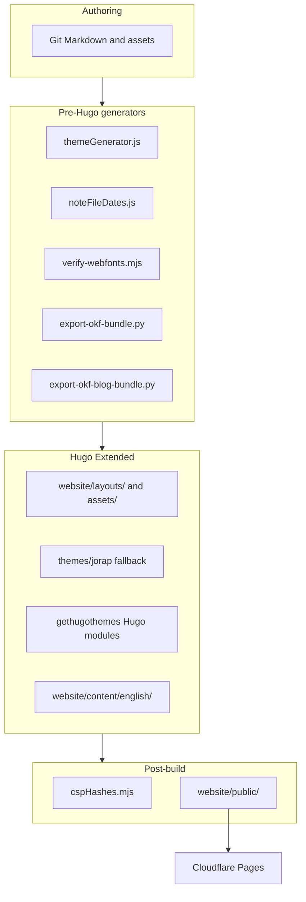

# Architecture

How JoRap.com is organized, what owns what, and which paths are generated vs hand-edited.

**Toolchain pins:** [`scripts/deploy-versions.json`](../scripts/deploy-versions.json) (Hugo, Node, pnpm, Go). Local optional: [`.mise.toml`](../.mise.toml).

## System shape

Static Hugo site under [`website/`](../website/) with a vendored theme fork, site-level overrides, Hugo Modules for vendor features, and a Node/Python tooling layer at repo root. Production deploy is always `pnpm run deploy` → [`scripts/deployBuild.mjs`](../scripts/deployBuild.mjs) (`hugo --source website`) — never bare `hugo`.

## Repo layout

| Path | Role |
| --- | --- |
| [`website/`](../website/) | Hugo site root: content, layouts, themes, assets, static, `hugo.toml`, `public/` |
| [`scripts/`](../scripts/) | Build, lint, deploy tooling (runs from repo root) |
| [`docs/`](./) | Long-form documentation |
| [`.context/project/`](../.context/project/) | Optional symlink to JA2B project notes — create locally after clone (not in git; see README) |

## Ownership map

| Layer | Path | Edit when… | Do not… |
| --- | --- | --- | --- |
| **Live site shell** | [`website/layouts/`](../website/layouts/), [`website/assets/`](../website/assets/) | Changing what visitors see (header, blog, notes garden, motion, SEO) | Assume `themes/jorap` copies are live — Hugo prefers site-root overrides |
| **Site theme** | [`website/themes/jorap/`](../website/themes/jorap/) | Theme templates; tokens in `assets/css/` | Edit stale duplicates of site overrides under `website/layouts/` |
| **Hugo Modules** | [`website/config/_default/module.toml`](../website/config/_default/module.toml), [`website/go.mod`](../website/go.mod) | Enabling vendor shortcodes/search/PWA | Edit Go module cache |
| **Site config** | [`website/hugo.toml`](../website/hugo.toml), [`website/config/_default/`](../website/config/_default/) | Engine settings, params, menus | Duplicate pins already in `deploy-versions.json` |
| **Design tokens** | [`website/data/theme.json`](../website/data/theme.json) | Colors, fonts, functional palette | Edit `generated-theme.css` (auto-generated) |
| **Content** | [`website/content/english/`](../website/content/english/) | Blog, notes, pages | Hand-edit OKF export trees (regenerate) |
| **Edge** | [`website/static/_headers`](../website/static/_headers), [`website/static/_redirects`](../website/static/_redirects) | Security headers, path redirects | Add `unsafe-inline` to site-wide `script-src` |
| **Tooling** | [`scripts/`](../scripts/) | Build, lint, export | Skip `deployBuild.mjs` for production |

### Hugo resolution order

`website/layouts/`, `website/assets/`, and `website/static/` **override** the same path under `website/themes/jorap/`. Many essentials partials exist **only** at the site root (`website/layouts/_partials/essentials/style.html`, `script.html`, etc.). When debugging templates, start under `website/`; use theme files as fallback or upstream sync targets.

### Notes garden boundary

All garden logic lives under `website/layouts/_partials/notes/` (~58 partials) plus `website/layouts/notes/`. Treat this as one bounded domain: `partialCached` keys and build-time walks are intentional. Do not flatten into generic Hugo patterns without a measured perf problem.

## Generated and derived files

| Output | Generator | Git policy |
| --- | --- | --- |
| `website/themes/jorap/assets/css/generated-theme.css` | `scripts/themeGenerator.js` | Tracked (required for Tailwind) |
| `website/data/noteFileDates.json` | `scripts/noteFileDates.js` | Tracked |
| `website/hugo_stats.json` | Hugo `[build.buildStats]` | Ignored; rebuilt each compile |
| `website/static/exports/okf/` | `export-okf-bundle.py` (every deploy) | Ignored |
| `website/static/exports/okf-blog/` | `export-okf-blog-bundle.py` (every deploy) | Ignored |
| `website/static/exports/jorap-notes-anki.txt` | `export:anki` (manual) | Tracked |
| `website/public/` | `pnpm run deploy` | Ignored |

**Rule:** If `deployBuild.mjs` regenerates a path every build, do not commit it unless there is an explicit reason (Anki export is the exception).

## Build and quality gates

| Command | Role |
| --- | --- |
| `pnpm run deploy` | Canonical production build (generators → Hugo → CSP) |
| `pnpm check` | Fast Node-only gates (filenames, blog-voice self-check) |
| `pnpm lint:garden` | Full notes garden quality (needs PyYAML) |
| `pnpm lint:blog` | Published blog voice and frontmatter |
| `pnpm garden:health` | Lint + Hugo + link Issues report |
| `pnpm test:search` | Search index smoke (run after build for full pass) |
| `pnpm aislop:ci` | Opt-in code-slop gate ([aislop](https://github.com/scanaislop/aislop); config `.aislop/config.yml`) |

Python lint dependency: `pip install -r scripts/requirements-dev.txt`. Deploy OKF export uses stdlib only (no root `requirements.txt` — avoids CF auto-pip on every build).

## CSS entry

Live global overrides: [`website/assets/css/custom.css`](../website/assets/css/custom.css) (feature slices via `@import`). Imported from [`website/themes/jorap/assets/css/main.css`](../website/themes/jorap/assets/css/main.css). Page-scoped CSS (`site-motion.css`, `cursor-usage.css`, `fonts.css`) loads via layout partials.

## Related docs

| Doc | Scope |
| --- | --- |
| [`SPEC.md`](./SPEC.md) | Product requirements |
| [`DESIGN.md`](./DESIGN.md) | Visual system |
| [`TROUBLESHOOTING.md`](./TROUBLESHOOTING.md) | Build and deploy gotchas |
| [`README.md`](../README.md) | Quick start |
