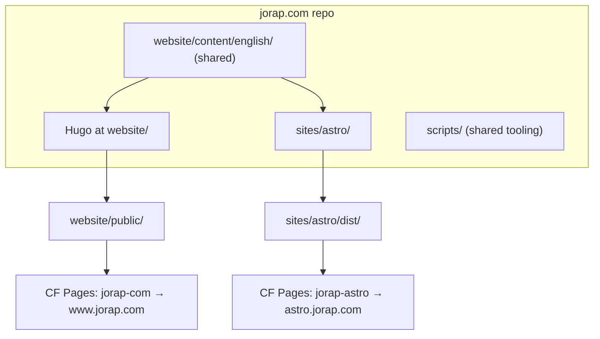

# Dual-site architecture: Hugo + Astro

**Status:** Planning (not implemented)  
**Last updated:** 2026-10-03  
**Canonical site:** [https://www.jorap.com](https://www.jorap.com)  
**Planned Astro site:** `https://astro.jorap.com`

This document captures the plan for running two static sites from one repo: the existing Hugo CMS at **jorap.com** (production, canonical) and an Astro equivalent at **astro.jorap.com** (showcase, learning, long-term dual stack with full feature parity as the goal).

Related: [`CLIENT_STATIC_SITE.md`](./CLIENT_STATIC_SITE.md) (Cloudflare deploy rails), [`SPEC.md`](./SPEC.md) (platform requirements).

---

## Goals

| Goal | Detail |
| --- | --- |
| **Dual stack** | Both sites stay live with different roles |
| **Showcase** | Astro version demonstrates the stack; Hugo remains canonical for SEO and CMS |
| **Full parity** | Blog, notes garden, graph, flashcards, search, CMS, etc. — phased delivery |

---

## Current state

- **One Hugo site** under [`website/`](../website/): ~440 markdown files in [`website/content/english/`](../website/content/english/) (count drifts with publishes), custom garden (wikilinks, backlinks, PixiJS graph, flashcards, search index), deploy via [`scripts/deployBuild.mjs`](../scripts/deployBuild.mjs) → `website/public/` → Cloudflare Pages project `jorap-com`.
- **No Astro code** today. [`CLIENT_STATIC_SITE.md`](./CLIENT_STATIC_SITE.md) already documents Astro on the same Cloudflare rails (output `dist`, cache `node_modules/.astro`).
- **pnpm workspace** exists ([`pnpm-workspace.yaml`](../pnpm-workspace.yaml)) but only lists `"."` — room to add a second package without restructuring Hugo.

---

## Recommended architecture: additive monorepo

Hugo lives in `website/` (repo root holds tooling and docs). Add Astro as a sibling package under `sites/astro/`.



| Concern | Hugo (canonical) | Astro (showcase / dual stack) |
| --- | --- | --- |
| Role | Production, CMS, SEO authority | Parity target, learning, future experiments |
| Build | `pnpm run deploy` | `pnpm --filter astro build` (or `cd sites/astro && pnpm build`) |
| Output | `website/public/` | `sites/astro/dist/` |
| Base URL | `https://www.jorap.com/` | `https://astro.jorap.com/` |
| Content | [`website/content/english/`](../website/content/english/) | Same paths via Astro content collections |

---

## Repo layout (target)

```
jorap.com/
├── website/                  # Hugo site — single source of truth for content
│   ├── content/english/
│   ├── layouts/, themes/, hugo.toml
│   └── public/               # deploy output
├── sites/astro/
│   ├── package.json
│   ├── astro.config.mjs
│   ├── src/
│   │   ├── content.config.ts # Zod schemas mirroring Hugo frontmatter
│   │   ├── pages/            # routes
│   │   ├── components/       # port from theme + layouts
│   │   └── lib/              # wikilink parser, backlink index, etc.
│   └── wrangler.toml         # second Pages project
├── scripts/                  # shared tooling
├── pnpm-workspace.yaml       # packages: [".", "sites/astro"]
└── package.json              # add astro:* scripts at root
```

---

## Cloudflare: two Pages projects, one repo

1. **Keep** existing project `jorap-com` (build command `pnpm run deploy`, output `website/public`).
2. **Create** `jorap-astro` (or similar):
   - Root directory: `sites/astro` (CF monorepo setting)
   - Build command: `pnpm install && pnpm build`
   - Output: `dist`
   - Build cache: enable; cache key includes `node_modules/.astro`
   - Custom domain: `astro.jorap.com` (CNAME to `*.pages.dev`)
3. **Build watch paths** (CF dashboard per project) to conserve the ~500 builds/month budget:
   - Hugo: `website/content/`, `website/layouts/`, `website/themes/`, `website/assets/`, `website/static/`, `website/hugo.toml`, `website/config/`, `scripts/deploy*`, `wrangler.toml`
   - Astro: `website/content/`, `sites/astro/`
4. Extend [`.cursor/rules/deploy-commits.mdc`](../.cursor/rules/deploy-commits.mdc) guidance: tooling-only commits still `[skip ci]`; content commits may trigger **both** builds unless watch paths narrow it.

---

## Shared content strategy

**One markdown tree, two consumers.** Astro reads from `../../website/content/english/` in `sites/astro/src/content.config.ts` — no copy, no symlink (avoids Windows symlink pain noted in [`README.md`](../README.md)).

| Hugo concept | Astro equivalent |
| --- | --- |
| Sections `blog`, `notes`, `pages` | Content collections with `type` field or separate collection globs |
| Frontmatter (`description`, `cards`, `review`, `aliases`, …) | Zod schemas — start strict on blog/notes fields lint already enforces |
| Wikilinks `[[note]]` | `remark-wiki-link` or small custom remark plugin + slug resolver |
| Shortcodes (`bible`, `youtube`, `card`, …) | MDX components or rehype handlers |
| Permalinks `/notes/:slug/`, `/blog/:slug/` | `getStaticPaths` + `trailingSlash: 'always'` in astro config |
| Custom outputs (`searchindex.json`, `llms`, issues) | Build-time scripts in `sites/astro/scripts/` or shared `scripts/` |

**Lint scripts** ([`package.json`](../package.json) `lint:garden`, `lint:blog`, etc.) stay content-path-based at root — they validate the shared source regardless of which SSG builds it.

---

## Phased delivery

Full parity is large (~150 layout partials, PixiJS graph, flashcard review, OKF export, CMS OAuth). Ship in phases; each phase is deployable.

### Phase 0 — Scaffold and deploy pipeline (1–2 days)

- [ ] Init Astro in `sites/astro/` (Tailwind v4 to match [`website/themes/jorap`](../website/themes/jorap/)).
- [ ] Homepage + one blog post + `/about/` from shared content.
- [ ] Second CF Pages project live at `astro.jorap.com` with a visible “Astro preview” banner linking to www.
- [ ] Root scripts: `pnpm astro:dev`, `pnpm astro:build`.

### Phase 1 — Blog and static pages

- [ ] Blog list/single, categories/tags, related posts.
- [ ] Static pages: about, contact, projects.
- [ ] SEO parity: port logic from [`website/layouts/_partials/jorap-basic-seo.html`](../website/layouts/_partials/jorap-basic-seo.html) and [`structured-data.html`](../website/layouts/_partials/structured-data.html) into Astro `<head>` component.
- [ ] RSS feed.

### Phase 2 — Notes garden core

- [ ] Notes list, single, breadcrumbs, TOC.
- [ ] Wikilink resolution + internal link rendering.
- [ ] **Backlinks**: build-time index (scan all notes, emit `Map<slug, incoming[]>` — same algorithm as Hugo's [`backlinks-index.html`](../website/layouts/_partials/notes/backlinks-index.html)).
- [ ] Broken-link / issues page (port [`website/layouts/notes/issues.html`](../website/layouts/notes/issues.html) logic).

### Phase 3 — Interactive garden

- [ ] Reuse client JS from [`website/assets/js/`](../website/assets/js/) where possible (graph, flashcards, search).
- [ ] Graph page: port PixiJS graph; feed it a JSON graph built at compile time.
- [ ] Flashcards + `/notes/review/`: same `localStorage` keys so review progress carries across sites (optional nice-to-have).
- [ ] Client search: Pagefind **or** port `searchindex.json` shape from Hugo.

### Phase 4 — Parity extras

- [ ] Export outputs: OKF / Copy MD / llms.txt routes (call existing Python exporters or reimplement minimal subset).
- [ ] PWA, cookie consent, theme switcher.
- [ ] **CMS**: either (a) second Sveltia `config.yml` entry pointing at same `content/` paths, or (b) defer — Hugo `/admin` remains canonical editor until Astro routes stabilize.
- [ ] Cloudflare Functions: add OAuth handlers only if Astro also serves `/admin` (JoRap has no `functions/` tree today; Git-based CMS is optional)

---

## What stays Hugo-only (acceptable early on)

Until a phase ships, document gaps on the Astro homepage:

| Feature | Short-term Hugo-only? |
| --- | --- |
| CMS `/admin` | Yes — edit in Hugo, both sites rebuild on content push |
| OKF / llms export | Yes — generated by Hugo build |
| Disqus comments | Yes — or embed same Disqus shortname in Astro blog template |
| Apex → www redirect | Unchanged on main domain only |

---

## Risks and mitigations

| Risk | Mitigation |
| --- | --- |
| **2× build minutes** on content commits | CF watch paths; batch edits; `[skip ci]` for non-content |
| **Frontmatter drift** | Zod schemas + run existing `pnpm lint:garden` / `lint:blog` in Astro CI step |
| **Wikilink / shortcode parity bugs** | Golden-file tests: pick 5–10 representative notes, assert rendered HTML snippets |
| **Scope creep** | Phase gates; Astro banner until Phase 3 complete |
| **Theme drift** | Share design tokens from [`website/data/theme.json`](../website/data/theme.json) or [`DESIGN.md`](./DESIGN.md); one Tailwind config source if feasible |

---

## Canonical URL policy

- **www.jorap.com** = canonical for SEO, social, CMS, external links.
- **astro.jorap.com** = `noindex` until intentionally flipped (add `<meta name="robots" content="noindex">` in Phase 0) to avoid duplicate-content penalties while parity is incomplete.
- Optional later: `rel="canonical"` on Astro pages pointing at Hugo URLs during transition.

---

## Success criteria

- Push to `website/content/english/blog/` updates both sites (when watch paths include content).
- Astro reproduces blog + notes URL shapes (`/blog/slug/`, `/notes/slug/`).
- Hugo production unchanged; zero regression on `pnpm run deploy`.
- Clear on-site labeling: Hugo = live site; Astro = preview/showcase until you remove `noindex`.

---

## Suggested first PR (Phase 0 only)

Smallest useful slice — no garden yet:

1. `sites/astro/` with Astro + Tailwind, content collections pointing at `../../website/content/english/blog/`.
2. `pnpm-workspace.yaml` + root scripts.
3. `sites/astro/wrangler.toml` for second Pages project.
4. Homepage, one blog post, `noindex`, link back to www.

**Estimate:** Phase 0 ~1–2 days; full parity ~several weeks of focused work (Phase 2–3 are the bulk).
